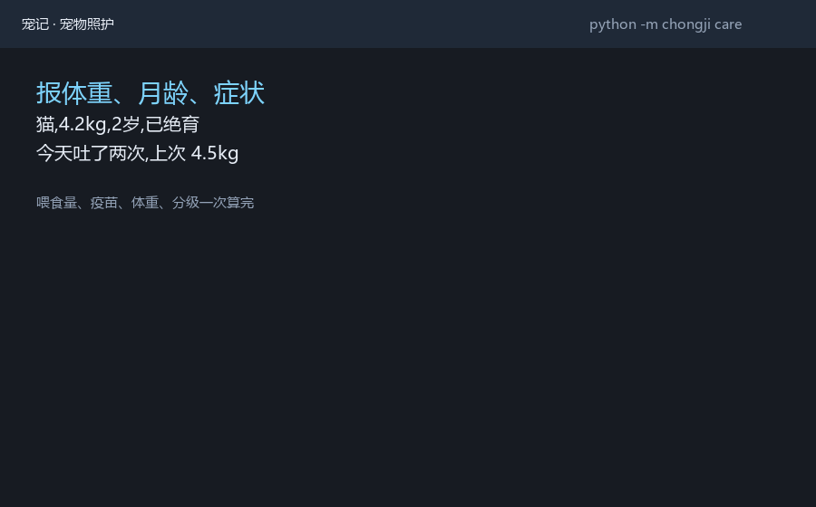
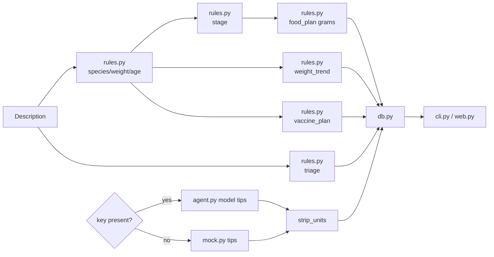

# ChongJi · Pet Care Assistant

[](https://github.com/wushiyi105-jpg/chongji/actions) []() [](./LICENSE) [](https://codecov.io/gh/wushiyi105-jpg/chongji)



> Give the weight, age and symptoms: get daily grams, the next vaccine and deworming dates, the weight trend, and a triage of watch / 24 hours / vet now.

Two questions come up constantly with pets: **how much should I feed**, and **does this need a vet tonight**. Overfeeding means soft stool, underfeeding means weight loss; waiting one night can turn a small problem into a big one. Feeding has a formula, vaccines have a calendar, symptoms have red flags. None of it should be guesswork.

**CLI + Web, zero third-party dependencies.**

## ✨ Features

- 🐾 **Two species profiles** — puppy, junior, adult neutered/intact, senior, diet: six stages with their own DER factor and meals per day
- 🍚 **RER/DER feeding maths** — `RER = 70 × weight^0.75`, `DER = RER × stage factor`, converted to grams by food density (dry 360, wet 95, homemade 130, raw 150 kcal/100g)
- 💉 **Vaccine and deworming calendar** — core, rabies, deworming, annual checkup; puppies scheduled by week, adults by months since last dose
- ⚖️ **Weight trend** — compare with "last time X kg"; a loss of 5% or more alerts, a gain of 8% suggests a diet
- 🚦 **Three-level triage** — 12 red flags first (urinary block, blood, seizures, poisoning, trauma), then 24-hour and watch levels; "occasional/light" downgrades
- 🏥 **Vet visit checklist** — weight, timeline, appetite and water, stool and urine, meds and vaccines, history
- 🔒 **Grams and calories stay local** — the model writes explanations only; "N g" and "N kcal" are stripped
- 🩺 **No diagnosis** — triage only, red flags always mean see a vet, no prescriptions

## 🚀 Quick start

```bash
git clone https://github.com/wushiyi105-jpg/chongji.git
cd chongji

cp .env.example .env      # optional: LLM_API_KEY

python -m chongji care --text "Cat, 4.2kg, 2 years, neutered, vomited twice today, last time 4.5kg"
```

Or keep it in `pet.txt` and run `python -m chongji care --file pet.txt --save`.

Docker:

```bash
docker build -t chongji .
docker run -p 8000:8000 chongji
```

## 🤔 Why not just ask a general LLM

A general model says "feed 2%–3% of body weight" or "monitor it". It cannot compute today's grams for your cat, and it should not diagnose. Four differences:

1. **Grams can be recomputed** — 4.2 kg neutered adult cat: `RER = 70 × 4.2^0.75 = 205.4 kcal`, ×1.6 = 328.6 kcal, ÷ 3.6 kcal/g = 91 g, 46 g per meal. Every step is in `rules.food_plan()`; switching to wet food gives 346 g because it only has 95 kcal/100g. "2%–3%" has neither a factor nor a food type.
2. **Vaccines are dates, not vibes** — a 3-month puppy gets its next core dose at 10 weeks; an adult cat gets boosters at 12 months and deworming at 3. `rules.vaccine_plan()` returns dates; models routinely say two puppy doses instead of three.
3. **Red flags outrank reassurance** — 12 red-flag terms trigger "vet now" immediately, no "wait and see". This rule lives in `data/species.json` and will not soften based on phrasing.
4. **Works offline** — feeding, vaccines, weight, triage and checklist are local; without a key you only lose the model's care tips.

## 🎯 Use cases

- **A new puppy**: 3 months, 4 kg — meals per day and grams per meal, plus the three vaccine doses and deworming schedule.
- **Cat stopped eating**: "cat 4kg, not eating for two days" surfaces the red flags and fatty-liver risk so you stop debating.
- **Switching food or dieting**: the 0.8 factor gives diet calories properly instead of just "feed less".
- **Weight dropping**: 4.5 → 4.2 kg is a 6.7% loss, flagged with the directions to investigate.
- **Late at night**: triage first; red flags go now, others get a timeline and a checklist for tomorrow.

## 🗺 Roadmap

- **Body condition score**: 1–9 by breed and frame, instead of a single weight heuristic.
- **Prescription diet matching**: calorie and protein ranges by condition (renal, urinary, pancreatitis), reference only.
- **Multi-pet records**: separate weight curves and vaccine schedules per pet.
- **Feeding log**: actual intake linked to weight, auto-correcting the suggested grams.
- **Visit record import**: store diagnosis and meds, so the next similar symptom has context.

## ❓ FAQ

**Is this veterinary diagnosis?**
No. Feeding maths, vaccine calendar and symptom triage only. Red flags always mean see a vet; prescriptions follow your vet.

**Why 91 g when someone says 60 g?**
Stage factor and food density. Neutered adult 1.6 with dry food at 360 kcal/100g; wet food multiplies the grams because it only has 95 kcal/100g. Check which food you are feeding.

**How are puppy vaccines scheduled?**
Core at 6/10/14 weeks, rabies at 16 weeks, booster at one year. Your vet's schedule wins; the tool gives reference dates.

**How much weight loss matters?**
5% within two weeks for adults warrants a recheck; continued loss means checking teeth, digestion, thyroid and kidneys. Seniors have a tighter threshold.

**Will the model change the grams?**
No. `agent.strip_units()` replaces "N g" and "N kcal" with a neutral phrase; numbers come only from `rules.food_plan()`.

## 📖 Commands

```bash
# 🐾 assess
python -m chongji care --text "..."
python -m chongji care --file pet.txt --save

# 🍚 food density and stage factors
python -m chongji foods

# 🚦 symptom triage
python -m chongji symptoms

# 🗂 history
python -m chongji history

# 🌐 web
python -m chongji web --port 8000

python -m chongji --json care --text "..."
python -m chongji --mock care --text "..."
```

## 🔌 Model configuration

Any **OpenAI-style `/chat/completions`** endpoint:

| Platform | `LLM_BASE_URL` | `LLM_MODEL` |
|---|---|---|
| DeepSeek (default) | `https://api.deepseek.com` | `deepseek-flash` |
| OpenAI | `https://api.openai.com/v1` | `gpt-4o-mini` |
| Local Ollama | `http://localhost:11434/v1` | `qwen2.5` |

## 🧠 How it works

```
description (species / weight / age / symptoms / last weight)
  │
  ├─ rules.species / weight_kg / age_months
  ├─ rules.stage ─────── six stages, factors and meals
  ├─ rules.food_plan ─── RER → DER → grams → per meal
  ├─ rules.weight_trend loss/gain percentage
  ├─ rules.vaccine_plan puppy doses / adult booster dates
  ├─ rules.triage ────── red → 24h → watch
  ├─ rules.vet_checklist six items to bring
  │
  ├─ model: care explanation / tips / risks (strip_units)
  └─ offline: mock.py assembles from stage and triage
  │
  └─ SQLite → CLI / Web
```

### Data flow



## 🗂 Layout

```
chongji/
├── chongji/
│   ├── rules.py    # species, stage, RER/DER, weight, vaccines, triage
│   ├── agent.py    # orchestration + unit stripping
│   ├── mock.py     # offline care tips
│   ├── db.py       # care records
│   ├── cli.py      # care / foods / symptoms / history / web
│   └── web.py      # single page + JSON API
├── data/species.json  # 2 species + 6 stages + 4 foods + 4 items + 3 tiers
├── examples/ (4 raw descriptions + cases.json)
│   └── out/ (matching CLI output)
├── tests/test_chongji.py      # 35 unit
├── tests/test_integration.py  # 20 integration
├── docs/regression-map.md     # issue -> test names
└── assets/demo.gif
```

## ✅ Tests

```bash
python -m unittest discover tests -v
```

55 tests in two layers. 35 unit tests cover local logic only: species and weight units, three age formats, six stages, RER/DER, dry vs wet grams, weight gain and loss, red/amber/green triage, vaccine dates, checklist, offline pipeline and unit stripping. 20 integration tests start a real ThreadingHTTPServer, drive `python -m chongji` as a subprocess and pin the four bugs fixed in this version (see docs/regression-map.md). CI runs them on 3.10/3.11/3.12; `v*` tags also push a multi-arch GHCR image.

## 👤 Author

Xiao Mi · 17612850106

## 📄 License

[MIT](./LICENSE)
