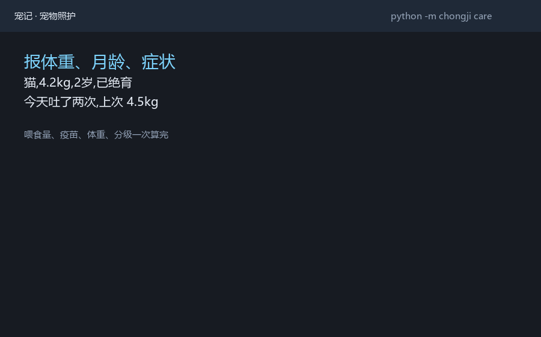
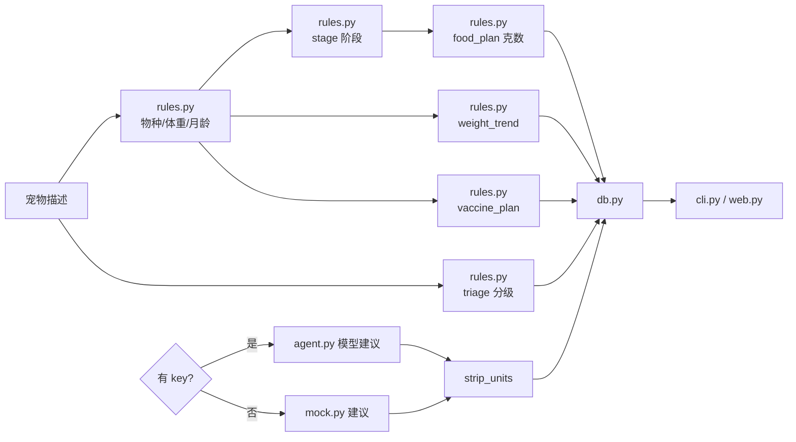

# 宠记 · 宠物照护

[](https://github.com/wushiyi105-jpg/chongji/actions) []() [](./LICENSE) [](https://codecov.io/gh/wushiyi105-jpg/chongji)



> 报体重、月龄和症状:算每日喂食克数、疫苗与驱虫的下次日期、体重涨跌,再把症状分成「观察 / 24 小时 / 立即就医」。

养宠最常见的两个问题:**到底该喂多少**,以及**这个症状要不要现在去医院**。喂多了软便,喂少了掉秤;症状拖一夜,小问题变大问题。喂食量有公式,疫苗有日历,症状有红旗清单,这些都不该凭感觉。

**CLI + Web,零第三方依赖。**

## ✨ 特性

- 🐾 **猫狗两套参数** — 幼年、成长、成体绝育/未绝育、老年、减重 6 个阶段,各自 DER 系数与每日顿数
- 🍚 **喂食量按 RER/DER 算** — `RER = 70 × 体重^0.75`,`DER = RER × 阶段系数`,再按食物热量密度折算克数(干粮 360、湿粮 95、自制 130、生骨肉 150 kcal/100g)
- 💉 **免疫与驱虫日历** — 核心疫苗、狂犬、体内外驱虫、年度体检,幼犬按周龄排针次,成体按上次接种顺延
- ⚖️ **体重趋势** — 对比「上次 X kg」,掉秤 ≥5% 报警,涨秤 ≥8% 提示减重
- 🚦 **症状三级分流** — 先匹配 12 个红旗(尿闭、吐血、抽搐、误食、车祸…),再分「24 小时内」「先观察」,「偶尔/轻微」优先降级
- 🏥 **就诊清单** — 体重、时间线、食欲饮水、排便排尿、用药疫苗、既往病史,6 项
- 🔒 **克数与卡路里只认本地** — 模型只写照护解释,输出里的「N g」「N kcal」会被剥掉
- 🩺 **不做诊断** — 只做分流与提醒,红旗一律建议就医,不给处方药

## 🚀 快速开始

```bash
git clone https://github.com/wushiyi105-jpg/chongji.git
cd chongji

cp .env.example .env      # 可选:LLM_API_KEY

python -m chongji care --text "猫,4.2kg,2岁,已绝育,今天吐了两次,上次 4.5kg"
```

也可以写进 `pet.txt`:`python -m chongji care --file pet.txt --save`。

Docker:

```bash
docker build -t chongji .
docker run -p 8000:8000 chongji
```

## 🤔 为什么不能直接问通用大模型

通用模型会说「按体重 2%–3% 喂」,或者「建议观察」。它算不出你家这只猫今天该吃多少克,也不该替兽医做诊断。差别在四点:

1. **克数可复算** — 4.2 kg 已绝育成猫:`RER = 70 × 4.2^0.75 = 205.4 kcal`,×1.6 = 328.6 kcal,DER ÷ 3.6 kcal/g = 91 g,分两顿每顿 46 g。每一步都在 `rules.food_plan()` 里,换成湿粮会变成 346 g,因为热量密度只有 95 kcal/100g。模型给的「2%–3%」既没有系数,也不区分干湿粮。
2. **疫苗按日期排,不按记忆** — 3 月龄幼犬,核心疫苗下一针在 10 周龄;成猫按上次接种顺延 12 个月、驱虫 3 个月。`rules.vaccine_plan()` 直接给日期,模型经常把幼犬三针说成两针。
3. **红旗优先,不给模糊建议** — 12 个红旗词命中就直接「立即就医」,不给「再观察看看」。这条规则写死在 `data/species.json`,不会因为提问语气改变。
4. **断网也能用** — 喂食量、免疫、体重、分流、清单全在本地;没有 key 只少照护建议那几句。

## 🎯 适用场景

- **刚接回家的小狗**:3 月龄、4 kg,先看每天几顿、每顿多少克,再排三针疫苗与驱虫日期。
- **猫突然不吃了**:输入「猫 4kg 不吃东西两天」,红旗与脂肪肝风险一起给出,不用犹豫要不要去医院。
- **换粮/减重**:用 0.8 系数算减重期热量,避免「少喂一点」变成饿肚子。
- **体重掉了**:上次 4.5 kg 现在 4.2 kg,掉秤 6.7% 直接报警,并列出要查的方向。
- **半夜不确定**:先分级,红旗立刻走,非红旗记录时间线,第二天带清单去面诊。

## 🗺 Roadmap

- **体况评分(BCS)**:按品种与骨架给 1–9 分,替代单一 BMI 式判断。
- **处方粮匹配**:按疾病类型(肾病、泌尿、胰腺)给出热量与蛋白区间,仅作参考。
- **多宠家庭台账**:每只宠物独立记录体重曲线与疫苗,提醒不串号。
- **喂食记录**:每日实际喂食量与体重联动,自动校正建议克数。
- **就诊记录回收**:把医院诊断与用药录回来,下次同类症状直接对照。

## ❓ FAQ

**这是兽医诊断吗?**
不是。只做喂食量计算、免疫日历与症状分流。红旗症状一律建议立即就医,处方与用药请遵医嘱。

**为什么我的猫建议 91 g,别人说 60 g?**
取决于阶段系数与食物热量密度。已绝育成猫系数 1.6、干粮 360 kcal/100g;换成湿粮克数会翻几倍,因为每 100 g 只有 95 kcal。先确认你喂的是哪种。

**幼犬疫苗怎么排?**
按 6/10/14 周龄三针核心疫苗,16 周龄狂犬;满 1 年加强。实际以兽医排期为准,工具只给参考日期。

**掉秤多少要紧张?**
成年宠物两周内掉 5% 以上建议复查;持续下降要查牙口、消化、甲亢、肾病。老年宠物阈值更严。

**模型会不会改克数?**
不会。`agent.strip_units()` 把「N g」「N kcal」替换成「相应份量」,数字只来自 `rules.food_plan()`。

## 📖 命令参考

```bash
# 🐾 评估
python -m chongji care --text "..." 
python -m chongji care --file pet.txt --save

# 🍚 热量密度与阶段系数
python -m chongji foods

# 🚦 症状分级
python -m chongji symptoms

# 🗂 历史
python -m chongji history

# 🌐 Web
python -m chongji web --port 8000

python -m chongji --json care --text "..."
python -m chongji --mock care --text "..."
```

## 🔌 模型配置

兼容 **OpenAI `/chat/completions`** 的任意服务:

| 平台 | `LLM_BASE_URL` | `LLM_MODEL` |
|---|---|---|
| DeepSeek(默认) | `https://api.deepseek.com` | `deepseek-flash` |
| OpenAI | `https://api.openai.com/v1` | `gpt-4o-mini` |
| 本地 Ollama | `http://localhost:11434/v1` | `qwen2.5` |

## 🧠 工作原理

```
描述(物种 / 体重 / 月龄 / 症状 / 上次体重)
  │
  ├─ rules.species / weight_kg / age_months
  ├─ rules.stage ─────── 6 个阶段系数与顿数
  ├─ rules.food_plan ─── RER → DER → 克数 → 每顿
  ├─ rules.weight_trend 掉秤/涨秤百分比
  ├─ rules.vaccine_plan 幼年针次 / 年度加强日期
  ├─ rules.triage ────── 红旗 → 24h → 观察
  ├─ rules.vet_checklist 6 项就诊材料
  │
  ├─ 模型:照护解释 / 建议 / 风险(strip_units)
  └─ 离线:mock.py 按阶段与分级组装
  │
  └─ SQLite → CLI / Web
```

### 数据流



## 🗂 目录结构

```
chongji/
├── chongji/
│   ├── rules.py    # 物种、阶段、RER/DER、体重、疫苗、分级、清单
│   ├── agent.py    # 编排 + 单位剥离
│   ├── mock.py     # 离线照护建议
│   ├── db.py       # 照护记录
│   ├── cli.py      # care / foods / symptoms / history / web
│   └── web.py      # 单页 + JSON API
├── data/species.json  # 2 物种 + 6 阶段 + 4 食物 + 4 免疫项 + 3 级症状
├── tests/test_chongji.py
└── assets/demo.gif
```

## ✅ 测试

```bash
python -m unittest discover tests -v
```

35 个单测只测本地逻辑:物种与体重单位、三种月龄写法、六阶段、RER/DER、干湿粮克数差、体重涨跌、红旗/琥珀/绿灯、疫苗日期、清单、离线全流程、单位剥离。CI 在 3.10/3.11/3.12 上跑。

## 👤 作者

shiyi · GitHub [@wushiyi105-jpg](https://github.com/wushiyi105-jpg) · [wushiyi105@gmail.com](mailto:wushiyi105@gmail.com)

## 📄 许可

[MIT](./LICENSE)
